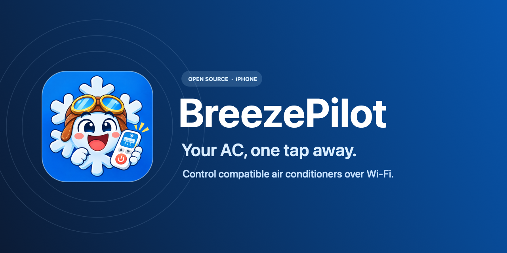
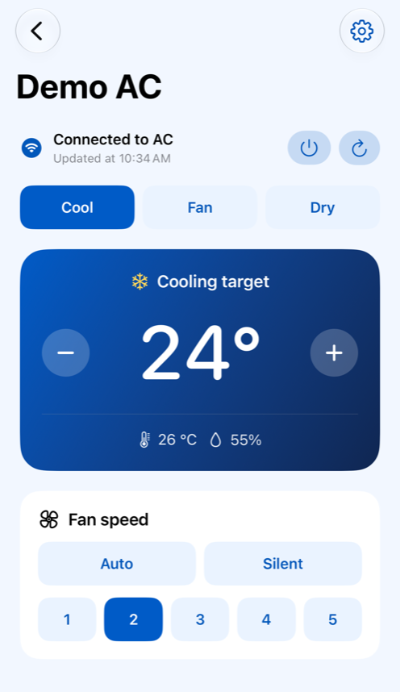
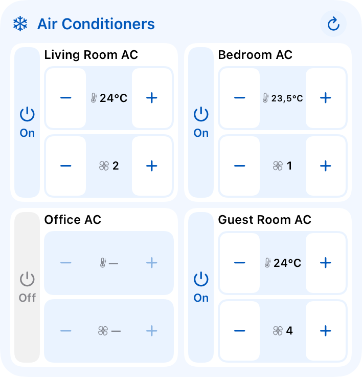

# BreezePilot — iPhone AC Remote



**Your AC, one tap away.** Switch your air conditioner on or off, set the temperature, and adjust the fan right from your iPhone’s Home Screen.

BreezePilot is an open source **iPhone AC remote and Home Screen widget** for compatible Daikin and Xiaomi / Mijia Wi-Fi air conditioners. It talks directly to your AC over your home network. Once installed, it runs on your iPhone without a Mac or a BreezePilot account.

[Build and install from source](#install-from-source)

| iPhone controls | Home Screen widget preview |
| :---: | :---: |
|  |  |

## What you can do

- Save multiple ACs, group them by room, and see their status in one place.
- Adjust power, temperature, mode, and fan speed. See room temperature and humidity when your unit reports them. Some models also expose Boost, Econo, Streamer, or Eco mode.
- Use the **Air Conditioners** Home Screen widget to see status and adjust power, temperature, and fan speed. Use its round refresh button to request a new reading.
- Add **Set AC Power** and **Set AC Temperature** to a shortcut in Apple Shortcuts.
- Save **Scenes** to apply settings across multiple ACs with one tap.

## Compatibility

| Brand | What you need |
| --- | --- |
| Daikin | A unit that supports the local `/dsiot/multireq` interface. |
| Xiaomi / Mijia | A compatible MIoT air conditioner and its 32-character hexadecimal device token. Setup fetches the model’s public specification. |

BreezePilot targets **iPhone with iOS 17 or later**. Your phone must be able to reach the AC’s local IPv4 address over Wi-Fi. Models and firmware vary in the controls they expose. If you try a model, [share what works](https://github.com/augarte/BreezePilot/issues).

### Can I use BreezePilot instead of the Daikin or Xiaomi Home app?

You can use BreezePilot for everyday controls once a compatible AC is on your Wi-Fi. Daikin ONECTA or Xiaomi Home (Mi Home) support alone does not establish compatibility. Check the local interface or token requirement above. Xiaomi setup fetches public model information, and everyday commands go directly to the AC.

## Install from source

1. Clone the repository and open `BreezePilot.xcodeproj` in an Xcode version that supports Swift 6.
   ```sh
   git clone https://github.com/augarte/BreezePilot.git
   cd BreezePilot
   open BreezePilot.xcodeproj
   ```
2. Create a file called `BreezePilot.local.xcconfig` beside `App.xcconfig`. This file is ignored by Git. Replace the example values with a unique bundle identifier and your Apple development team ID.
   ```xcconfig
   BREEZEPILOT_BUNDLE_ID = com.example.breezepilot
   DEVELOPMENT_TEAM = YOUR_TEAM_ID
   ```
3. For widget and Shortcuts access, [register an App Group](https://developer.apple.com/help/account/identifiers/register-an-app-group/) named `group.` followed by your bundle identifier. Assign it to both App IDs, the app identifier and its `.widgets` counterpart. The app and widget must use the same team and group. If you already have a registered group, set `BREEZEPILOT_APP_GROUP` in the same local file.
4. Choose the **BreezePilot** scheme and your iPhone, then click **Run**. In the app, tap **Add AC**, pick the brand, and enter the local address. For Xiaomi, enter the token and use **Check Connection** before saving. Allow Local Network access when prompted.

To run the in-app controls with a signing setup that does not support App Groups, add `CODE_SIGN_ENTITLEMENTS =` to the local configuration. Home Screen controls and Shortcuts require the shared App Group.

## Add the Home Screen widget

Add **Air Conditioners** from the iPhone widget gallery. Touch and hold the widget, choose **Edit Widget**, and select your saved ACs. The layout adapts to your selection.

| Size | ACs shown |
| --- | --- |
| Small | 1 |
| Medium | 1 or 2 |
| Large | 1 to 4 |

If an AC shows **Unavailable**, try the round refresh button. If it still fails, check that the phone and AC can reach each other over Wi-Fi and that **Local Network** access is enabled for BreezePilot.

## Create a scene

In **Scenes**, create a scene, give it a name, and add the ACs you want to control. Choose each AC’s desired power, mode, temperature, and fan speed, or leave individual settings as they are. For example, **Sleep** can turn off a living room AC and set a bedroom AC to Cool at 26°C.

Tap the play button to apply the scene. The result shows which ACs responded and lets you retry failed units. Add the **AC Scenes** Home Screen widget and select one, two, or up to four scenes depending on the size. You can also use **Run AC Scene** in Apple Shortcuts.

## Develop and contribute

Use the **BreezePilot** scheme with an iPhone simulator and press **⌘U**. The unit and UI tests use fixtures and run without AC hardware. Open `Widgets/ACWidgetPreviews.swift` in the Xcode Canvas to see supported sizes and states. Verify Home Screen interactions on a physical iPhone when changing widget actions.

| Path | Contents |
| --- | --- |
| `Sources/Domain` | AC state, room readings, and capabilities |
| `Sources/Application` | Device interface, confirmed changes, and App Intents |
| `Sources/Infrastructure` | Daikin and Xiaomi protocols, model lookup, and Keychain storage |
| `Sources/Presentation` | SwiftUI screens and view models |
| `Widgets` | Widget configuration, timeline, views, and previews |

See [CONTRIBUTING.md](CONTRIBUTING.md) for reporting issues, adding model support, and opening pull requests.

## Privacy and license

AC control stays on your local network. Xiaomi setup fetches public model information over HTTPS and stores the device token in the iPhone’s Keychain. See [PRIVACY.md](PRIVACY.md) for details and [SECURITY.md](SECURITY.md) for private vulnerability reporting.

BreezePilot is available under the [MIT License](LICENSE). It is an independent project.
